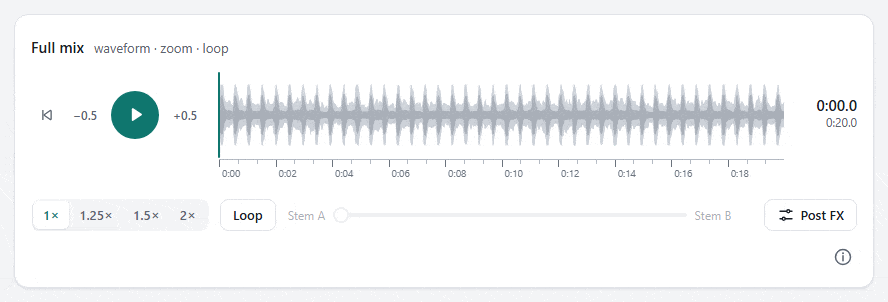
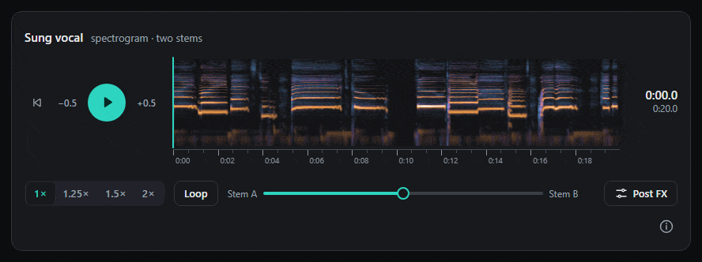
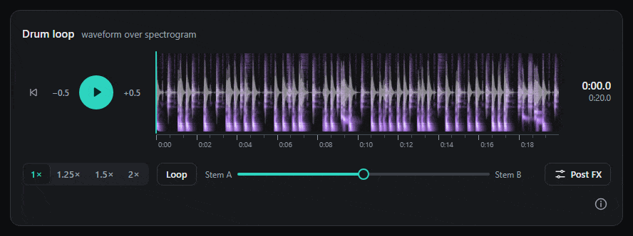
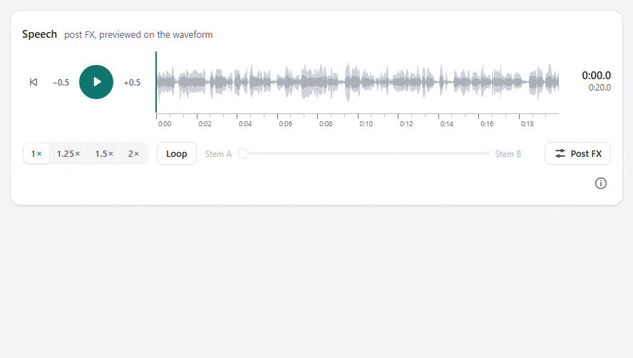
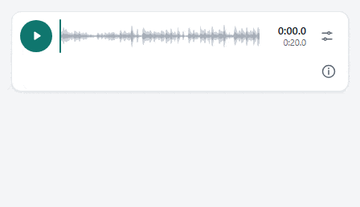
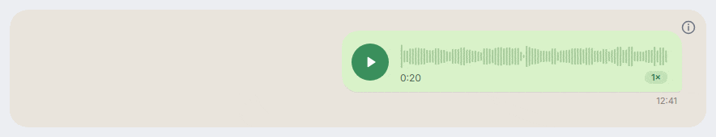
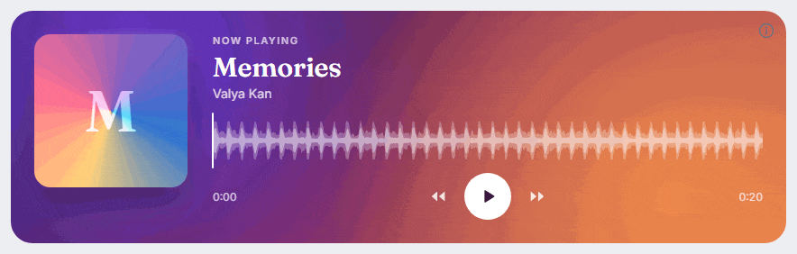
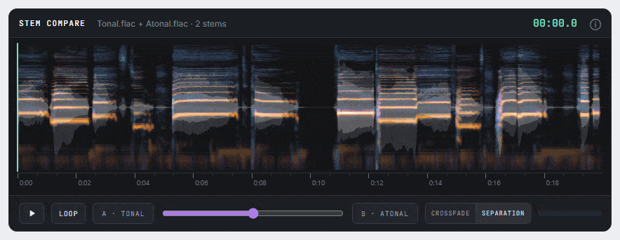
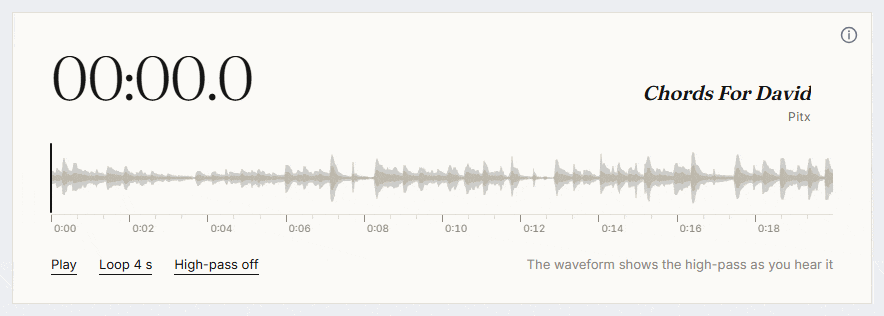
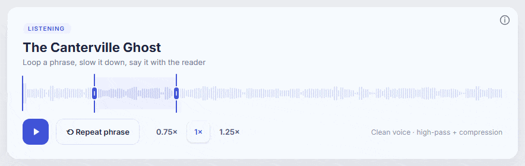

# RT-DSPPLR

**An audio player for web pages that works like a DAW — by SAIT Digital.**

**Documentation, live demo and API reference: [sait.digital/research/rt-dspplr](https://sait.digital/research/rt-dspplr).**

RT-DSPPLR plays a recording together with another version of it, such as the
same take before and after processing, and moves between the two with one
slider while it plays, with no gap and no drift. The speed changes without
changing the pitch, any section can be looped, and the waveform and the
spectrogram show the whole recording. Use the ready-made React player, or build
your own interface on the engine, which works without React. TypeScript types
are included.

## Features

- **Playback:** seek, step through the audio, loop any section.
- **Speed without a pitch change:** changed instantly while it plays; held notes
  stay smooth and drum hits do not double.
- **Effects in real time:** high-pass filter, compressor, output gain and a
  limiter, and your own plugins.
- **Waveform:** click to seek, drag to loop, zoom and scroll.
- **Spectrogram:** of both tracks, on a logarithmic frequency scale, redrawn as
  the slider moves.
- **Two tracks, one slider:** A and B play in sync. What goes on them is up to
  you: before and after processing, two mixes of a song, or the two parts of a
  separation, with the original in the middle.
- **React component:** fits any width, light and dark themes, keyboard control.
- **Your own interface:** an engine without a UI, and the timeline, the
  spectrogram and the author menu without React, for any framework.

Short files are decoded whole in the browser. Long ones, up to hours, can be
**prepared once on your server** with the same package (in Node) and then
streamed: the whole waveform and spectrogram appear at once, only the audio
around the playhead is downloaded (and starts playing while it downloads, in every format),
and the first move of the slider to the other version is heard at once.

## How it works

```
 SERVER, once per recording (rtd-prepare)       BROWSER (@saitdigital/rt-dspplr)
 ──────────────────────────────────────────     ────────────────────────────────────────
  recording + versions (stems)                   play({ manifest })
    │ decode, analyse, align the stems             1. manifest.json (13-17 KB / 30 min)
    ▼                                              2. coarsest pictures: whole timeline drawn
  peaks.bin  bands.bin  spectrogram.bin            3. the segment at the playhead first,
    │                                                 by Range; plays as its bytes arrive
    ▼                                              4. a seek fetches from the playhead
  index of the original file:                      5. the rest behind it, giving way
    segments of ~192 KB, entry points every          │
    0.5 s (entries.bin); checked sample by           ▼
    sample against the player's decode           AudioWorklet engine: A + stem from the
    │                                              same sample, the slider's mix, speed
    ▼                                              (tonal: Signalsmith, attacks: overlap-add),
  manifest.json + .bin files + the original      resampled to the sound card
  file, as it was ─── plain HTTP, Range ───▶       │
                                                   ▼
                                                 effects → ceiling → speakers
```

Nothing is converted: the player fetches parts of the original file by HTTP Range requests,
decodes them as they arrive (WAV, MP3, FLAC, Ogg Opus) and plays as soon as half a second is in.
Over 2 Mbit/s, 30 minutes with a stem start in 0.35-0.52 s and seek anywhere in 0.11-0.18 s.
The whole pipeline, step by step: [docs/how-it-works.md](docs/how-it-works.md).

## The package

One package, [`@saitdigital/rt-dspplr`](packages/rt-dspplr/README.md), holds both sides, at one version:

| Entry | Runs in | |
|---|---|---|
| `@saitdigital/rt-dspplr`, `/react`, `/advanced` | browser | The player: headless engine, React component, timeline, spectrogram, prepared-file playback. |
| `@saitdigital/rt-dspplr/format` | anywhere | The file formats and the manifest schema (`/manifest.schema.json`). |
| `@saitdigital/rt-dspplr/prepare`, `rtd-prepare` CLI | Node ≥ 20.3 | Preparing long recordings: the source's index, overview files and named stems, see [PREPARE.md](packages/rt-dspplr/PREPARE.md). |

Browser bundles never include the Node side: it is only loaded where it is imported.

The prepared-file format is specified in [docs/manifest.md](docs/manifest.md).

## The ready-made player

Waveform with zoom, pan and loop:



Two stems on a live spectrogram, each in its own colour, following the mix slider:



The waveform as an outline over the spectrogram:



High-pass, compression and output gain, previewed on the waveform as they move:



The compact layout for narrow containers:



## Your own interface on the same engine

The same engine under five interfaces built with `useAudioPlayer()` and
`<Timeline>`. Their code is in [examples/gallery](examples/gallery), one file per
design: run `npm ci && npm run gallery`, then choose or drop your own audio. The
interfaces are examples and are not part of the package.











Audio in the animations:

- *Memories* by Valya Kan, [CC BY 4.0](https://archive.org/details/yarn020)
- *Ophelia's Song* (vocals) by musetta, sung by Marinella Mastrosimone,
  [CC BY 2.5](https://ccmixter.org/files/musetta/6343), split into two stems with EQSEP 2
- *Chords For David* by Pitx, [CC BY 3.0](https://ccmixter.org/files/Pitx/30638)
- *Muzikemo Drum Essentials* by Muzikemo, [CC BY 4.0](https://archive.org/details/MuzikemoDrumEssentials),
  split into two stems with EQSEP 2
- *The Canterville Ghost* by Oscar Wilde, read by David Barnes for
  [LibriVox](https://archive.org/details/canterville_ghost_librivox), public domain

## Install

```bash
npm install @saitdigital/rt-dspplr   # the player, and on the server the prepare step
```

The React component additionally needs `react >= 18` and your application's React
renderer. The headless engine has no React requirement. The package is ESM-only.

## React quick start

```tsx
import { AudioPlayer } from '@saitdigital/rt-dspplr/react';
import '@saitdigital/rt-dspplr/styles.css';

export function App() {
    return (
        <AudioPlayer
            src="/audio/example.ogg"
            title="Example track"
            theme="dark"
        />
    );
}
```

The component manages loading and playback. Its author menu is built in: right-click
the player, use the context-menu key / Shift+F10, or tap the ⓘ button.
For playlists and custom controls, use
[`useAudioPlayer()` and the controlled component](packages/rt-dspplr/README.md#react-quick-start).

## Your own interface

```ts
import { createAudioPlayer } from '@saitdigital/rt-dspplr';

const root = document.querySelector<HTMLElement>('#player')!;
const player = createAudioPlayer({ element: root });

root.querySelector<HTMLButtonElement>('[data-play]')!.onclick = async () => {
    await player.play('/audio/example.ogg');
};
```

Give the player the element your interface lives in, and its author menu is there:
right-click, the context-menu key / Shift+F10, and a tappable ⓘ button. It needs no
framework and no stylesheet. Playback needs an element on the page; without one,
`play()` rejects with an error that says so. With React, put `ref={player.ref}` from
`useAudioPlayer()` on your root, or call `player.mount(element)` in any framework.

## Long recordings

```bash
npx rtd-prepare talk.wav public/media/talk
```

```ts
await player.play({ manifest: '/media/talk/manifest.json' });
```

See [PREPARE.md](packages/rt-dspplr/PREPARE.md) for the CLI, the API (`@saitdigital/rt-dspplr/prepare`),
named stems and server-side processors, and
[Long recordings](packages/rt-dspplr/README.md#long-recordings-prepared-files) for the
player side.

## Documentation

- [How it works: the pipeline from the server to the speakers](docs/how-it-works.md)
- [API, React examples, themes, browser support and memory](packages/rt-dspplr/README.md)
- [Preparing long recordings](packages/rt-dspplr/PREPARE.md) and [the manifest format](docs/manifest.md)
- [Speed and time stretch](packages/rt-dspplr/README.md#speed-and-time-stretch)
- [Workers, bundlers and CSP](packages/rt-dspplr/README.md#bundlers-workers-csp)

Rubber Band is optional and not bundled. The built-in realtime stretch works without it.
Rubber Band is GPL, which does not combine with this player's license: shipping the
Rubber Band entry in an application other people get, a web page included, needs a
commercial Rubber Band licence. See [Rubber Band's terms](https://breakfastquay.com/rubberband/license.html).

## License and attribution

Free to use, including in commercial, closed-source apps and hosted services, on
two conditions:

1. **The credit stays.** Right-clicking the player shows **RT-DSPPLR by SAIT
   Digital** with a link to the project; on touch devices the ⓘ button does. The
   player does this by itself in any interface. Do not remove or hide it.
2. **Changes to the player stay open.** If you ship a modified player, or serve it
   to people outside your organization, publish its source under the same license.
   Your own application code stays closed. Options, themes and your own interface
   on the public API are not modifications.

The [license](LICENSE.md) fits on one page. It is a custom, source-available
license, not an OSI-approved one.

The examples in [examples/](examples) and the code samples in the READMEs are
under MIT No Attribution ([examples/LICENSE.md](examples/LICENSE.md)): copy and
change them freely. The player they use keeps its own license.

## Try it

The demo, with every option and call of the API to try on prepared recordings and
their stems, is at [sait.digital/research/rt-dspplr](https://sait.digital/research/rt-dspplr), next to the API
reference and the changelog.

Locally, from a clone of this repository (Node.js 22+ and npm), the gallery runs
the interfaces shown above on your own audio:

```bash
npm ci
npm run dev
```

## Development

```text
packages/rt-dspplr/   the package: the player (src/), the prepare step (src/prepare/), documentation and tests
examples/gallery/    the five interfaces shown above
```

```bash
npm run build          # the package (player, then ./prepare) and the gallery
npm run typecheck
npm test
npx playwright install chromium
npm run test:browser   # audio, workers, React and attribution UI
npm run test:package   # install the tarball in an isolated consumer (the rtd-prepare CLI's output played in Chromium)
```

After changing library source, run `npm run build:lib` and refresh the demo.
The demo consumes `dist/`, not library source. Build checks verify the optional
Rubber Band boundary and generate a bundle size report.

See [RELEASING.md](RELEASING.md) for publication steps and [CHANGELOG.md](CHANGELOG.md) for what changed.
